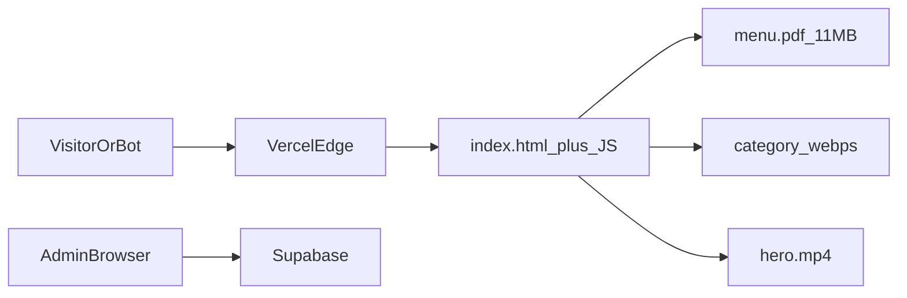

# Vercel Fast Data Transfer Audit (Angular SPA)

This is **not Next.js**. It is an Angular 21 static SPA (`restro-menu`) deployed with [`vercel.json`](vercel.json) (`framework: null`, SPA rewrite to `index.html`). Public visitors never hit Supabase; they download static files from the Vercel deployment. Next.js items (ISR, `next/image`, `force-dynamic`, App Router) do not apply.

Typical **first homepage visit** can transfer on the order of **~24 MB** from Vercel (PDF prefetch + all category WebPs + hero video + JS/CSS + logo), which is enough to burn a 100 GB Hobby allowance with a few thousand unique visitors (or far fewer if crawlers execute the SPA).

---

## A. Executive Summary

**Risk: high.**

Why:

- [`src/app/app.ts`](src/app/app.ts) prefetches [`public/images/menu/menu.pdf`](public/images/menu/menu.pdf) (**11.6 MB**) on **every** app boot (home, `/home`, `/menu`, even `/admin`), via idle callback + `<link rel="preload">` + `fetch`.
- The homepage is a single page that embeds the menu ([`home.html`](src/app/public-menu/home/home.html)). All **14 category WebPs (~10.3 MB)** are in the DOM at once, at **~2200–2480px** wide, displayed at most **~420px** wide (`max-width: 420px`, 3:4 cards). No `loading="lazy"`.
- [`public/images/hero.mp4`](public/images/hero.mp4) (**1.9 MB**) autoplays on every home view.
- [`public/images/Logo.png`](public/images/Logo.png) is **1920×1080 / 315 KB** for a **44–64px-tall** navbar logo.
- No `robots.txt`. The SPA rewrite serves `index.html` for unknown paths; bots that run JS will also hit the PDF prefetch.
- Google Fonts and the pdf.js worker on unpkg **do not** count as Vercel Fast Data Transfer.

Public data path: one `fetch('/data/site-data.json')` (**115 KB**, `cache: 'no-cache'`). Admin CRUD goes **browser → Supabase** (not Vercel FDT). Admin publish polling hits `/api/publish-status` only after an authenticated publish.

---

## B. Top Bandwidth Risks

| Priority | File / Route | Problem | Why it increases transfer | Estimated impact | Risk to change |
| -------- | ------------ | ------- | ------------------------- | ---------------- | -------------- |
| Critical | [`app.ts`](src/app/app.ts) + [`menu-pdf-prefetch.service.ts`](src/app/core/services/menu-pdf-prefetch.service.ts) + `/images/menu/menu.pdf` | Prefetch 11.6 MB PDF on every visit | Unique visitors, crawlers, and admin sessions download the PDF even if they never open `/menu` | **Critical** — often the majority of GB | **Low** if prefetch is removed and `/menu` still fetches on demand |
| High | `/images/menu/*.webp` (14 files, ~10.3 MB) | Full-page scans (~A4) used as cards; no lazy load | Homepage `#menu` loads all cards; signatures reuse the same huge files | **High** — similar order to PDF for users who reach the menu section | Lazy-load: **low**. Re-encode/resize: **medium** (visual QA) |
| High | [`home.html`](src/app/public-menu/home/home.html) `hero.mp4` | 1.9 MB autoplay video from Vercel | Every home view | **Medium–high** | Changing autoplay/poster-only is **medium** UX risk |
| Medium | [`Logo.png`](public/images/Logo.png) | 315 KB / 1920×1080 for 64px UI | Navbar + drawer (one network request, still huge) | **Medium** | Re-export: **low–medium** (must not look blurry) |
| Medium | No Cache-Control in [`vercel.json`](vercel.json); `framework: null` | Unhashed `/images/*`, `/data/site-data.json`, PDF get short default cache | Repeat visits and extra 200s instead of 304s | **Medium** for hashed JS/CSS; smaller for JSON | **Low** if hashed assets are `immutable`; **review** for JSON/PDF/images |
| Medium | No [`robots.txt`](public/robots.txt) + SPA rewrite | Bots get full SPA for `/admin`, `/api` probes, junk URLs | Each executed page load can prefetch the PDF + assets | **Medium–high** with crawlers | **Low** to disallow `/admin` and `/api` only |
| Low | [`loading_logo.webp`](public/images/loading_logo.webp) + GIF (433 KB) | Spinner shown at 120×120 | Extra ~220 KB when menu JSON is loading | **Low** | Compress: **low–medium** |
| Low | [`menu.service.ts`](src/app/core/services/menu.service.ts) `cache: 'no-cache'` | 115 KB JSON revalidated every load | Small vs media | **Low** | Changing freshness vs publish: **review** |
| Low | Unused JPGs + [`src/assets/images/banner.jpg`](src/assets/images/banner.jpg) | ~0.5 MB shipped | Deployed but barely requested | **Low** | Delete only after confirm unused |

Admin `setInterval` 5s on [`dashboard.ts`](src/app/admin/dashboard/dashboard.ts) is **not** a public FDT driver (auth-only, tiny JSON).

---

## C. Quick Wins (implement after approval)

High confidence, low production risk, no visual recompression of food photos:

1. **Stop global PDF prefetch** in [`src/app/app.ts`](src/app/app.ts). Keep [`MenuPdfPrefetchService`](src/app/core/services/menu-pdf-prefetch.service.ts) for `/menu` and the homepage “Download full menu” click (`downloadFullMenu` already calls `ensurePrefetched()`). Remove idle `prefetch()` + preload `<link>` from app boot. **Expected:** ~11.6 MB saved per visit that never opens/downloads the PDF.
2. **Add `loading="lazy"` + `decoding="async"`** on below-the-fold ``s: category cards, signatures, story photo, map. Keep logo, favicons, and hero poster eager. **Expected:** users who do not scroll to `#menu` skip ~10 MB; horizontal off-screen cards also skip.
3. **Add [`public/robots.txt`](public/robots.txt)** allowing `/` and `/menu`, `Disallow: /admin` and `Disallow: /api/`. Do not block `/` or the PDF URL globally.
4. **Add Vercel `headers` in [`vercel.json`](vercel.json)** for hashed `*.js` / `*.css`: `Cache-Control: public, max-age=31536000, immutable`. Optionally `max-age=0, must-revalidate` for `/data/site-data.json` so ETags/304s still work after publish. **Do not** publicly cache `/api/*`.
5. **Stop copying `public/.DS_Store`** via [`angular.json`](angular.json) asset ignore (tiny, hygiene).

Do **not** mechanically replace every `` with an optimizer (no Next.js image pipeline; Angular `NgOptimizedImage` will not magically resize files on Vercel).

---

## D. Bigger Optimizations (Requires Approval)

- **Re-encode category WebPs** to ~840px wide (2× of 420px display), quality kept high. Biggest remaining win after stopping PDF prefetch. Needs visual QA on menu + signatures.
- **Replace `Logo.png`** with a small WebP/PNG (~2× 360×64). Keep original until verified.
- **Host `menu.pdf` and/or `hero.mp4` on object storage/CDN** (Supabase Storage, R2, etc.) so bytes leave Vercel FDT. Architecture change; update `file_url` / video `src`.
- **Mobile: poster-only or smaller hero video** (`preload` / `matchMedia`). UX change.
- Remove unused `sig-*.jpg`, `story-chef.jpg`, `menu-mix.jpg`, `menu-lamb.jpg`, `plain-mixed-rice.jpg`, duplicate `banner.jpg` after a second usage pass.
- Split Bootstrap JS (global [`angular.json`](angular.json) scripts) — bundle size, not the main GB driver.
- **Do not self-host Google Fonts on Vercel** — that would **increase** FDT.

---

## E. Suspicious Traffic Patterns

- PDF prefetch + preload on **all routes**.
- Homepage mounts **all** category and signature images immediately.
- SPA rewrite: unknown paths → `index.html` → JS → same media/PDF behavior.
- Duplicate URLs `/` and `/home` (same Home chunk).
- `downloadFullMenu()` pulls the full PDF through Vercel (correct, but expensive; should stay on-demand).
- No polling on the public site. Admin 5s poll is authenticated and small.
- pdf.js worker: **unpkg**, not Vercel. pdf.js library chunk loads only with lazy `/menu` route — good.
- No proxy of remote media through Vercel APIs.

---

## F. Recommended Changes (detail)

**1. Stop boot-time PDF prefetch** — files: [`src/app/app.ts`](src/app/app.ts). Current: idle prefetch of `/images/menu/menu.pdf`. Proposed: only fetch when `/menu` loads or user clicks download. Benefit: ~11.6 MB per non-PDF visit. Side effect: first `/menu` open slightly slower. Test: home does not request `menu.pdf`; `/menu` still renders; download still works.

**2. Lazy-load below-fold images** — files: [`menu.html`](src/app/public-menu/menu/menu.html), [`story.html`](src/app/public-menu/story/story.html), [`contact-us.html`](src/app/public-menu/contact-us/contact-us.html). Benefit: skip off-screen/below-fold media. Side effect: brief delay when scrolling to menu. Test: cards still show; error fallback to `menu-kofta.jpg` still works.

**3. robots.txt** — new [`public/robots.txt`](public/robots.txt). Benefit: fewer bot hits on admin/API. Side effect: none for Google on the public site. Test: file served at `/robots.txt` (exists as static file so rewrite does not apply).

**4. Cache-Control for hashed bundles** — [`vercel.json`](vercel.json). Benefit: repeat visits skip JS/CSS bodies. Side effect: none for hashed filenames. Test: production response headers on `*.js`.

**5. Requires Approval (not auto-implemented):** resize/recompress WebPs and logo; move PDF/video off Vercel; hero video strategy; delete unused JPGs.

**Not changing (safe / N/A):** auth, API CORS, publish polling interval, `cache: 'no-cache'` on `site-data.json` (until you accept possible stale menu after publish), API response shape, Supabase selects (admin-only, already projected), rate limits.

---

## G. Production Safety Checklist

- Home hero video, logo, and LCP still look correct.
- `/menu` PDF viewer still renders all pages and download still works.
- Homepage “Download full menu” still downloads `fawzy-elkabaggy-menu.pdf`.
- Category images and signature carousel still load when scrolled into view.
- Admin login, publish, and `/api/publish` still require a bearer token.
- `/data/site-data.json` still updates after a publish/deploy (no long browser cache on that JSON).
- `robots.txt` does not `Disallow: /`.
- No new secrets in the client.

---

## HOW TO VERIFY THIS IN VERCEL

1. **Usage → Fast Data Transfer**: note GB used and **GB/day** for 3–7 days **before** deploy (Hobby 100 GB).
2. After deploy, compare **the same metric over an equal window** (same days of week if traffic is weekly). Absolute GB this month will still rise; look at **daily rate**.
3. **Observability → Edge Requests** (if available): path breakdown. Expect a sharp drop in requests/bytes for `/images/menu/menu.pdf` on `/` vs `/menu` only.
4. Chrome DevTools Network on production: homepage should **not** show `menu.pdf`; `/menu` should. Category WebPs should show as lazy (many `(pending)` until scroll).
5. Fast Data Transfer counts **bytes from Vercel to clients**. Browser → Google Fonts, unpkg, and Supabase **do not** reduce this dashboard. PDF/video moved off Vercel **would**.

---

## Implementation scope (after you approve this plan)

Only items 1–4 above (plus `.DS_Store` ignore). Then run the repo’s `npm test` / `ng build` as available and report the diff. Image recompression and CDN moves wait for explicit approval.
